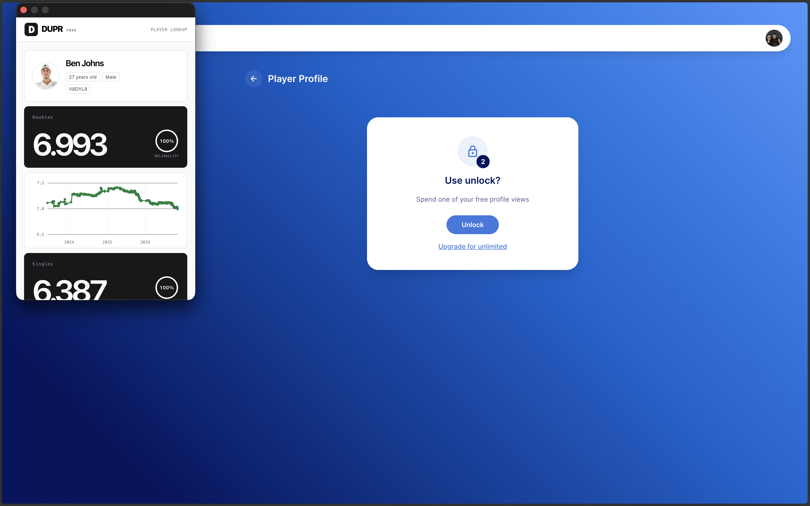

# DUPR Free Chrome extension

## Why

DUPR Free displays the profile, ratings, and match history for the player whose
profile is open in the DUPR dashboard. It runs when you click the extension on
a URL like
`https://dashboard.dupr.com/dashboard/player/4915220849`.

## Install from the ZIP

1. [Download the latest ZIP](https://github.com/namitoyokota/dupr-free/archive/refs/heads/main.zip).
2. Unzip the downloaded file.
3. Open Chrome.
4. Navigate to `chrome://extensions`.
5. Turn on **Developer mode**.
6. Choose **Load unpacked** and select the `dupr-free-main` folder.
7. Open DUPR and click the **DUPR Free** extension icon.

## Fair warning

I vibe-coded this project, so I have no idea what's inside this codebase.