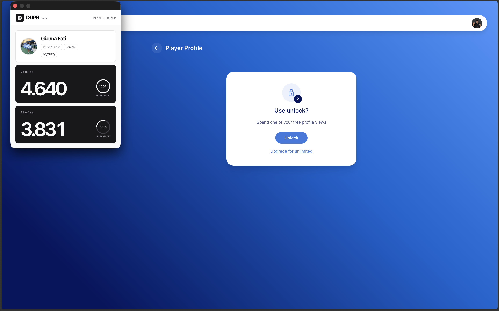

# DUPR Free Chrome extension

## Why

DUPR Free displays the profile, ratings, and match history for the player whose
profile is open in the DUPR dashboard. It runs when you click the extension on
a URL like
`https://dashboard.dupr.com/dashboard/player/4915220849`.

## Install for local use

1. Open `chrome://extensions`.
2. Turn on **Developer mode**.
3. Choose **Load unpacked** and select this `extension` folder.
4. Open a player profile on `dashboard.dupr.com` while signed in.
5. Click the extensions puzzle icon and pin **DUPR Free** if desired.
6. Click **DUPR Free** to show that player's details, ratings, and match history.
   Click a player in match history to update the popup with their profile
   without navigating the dashboard tab.

## Fair warning

I vibe-coded this project, so I have no idea what's inside this codebase.